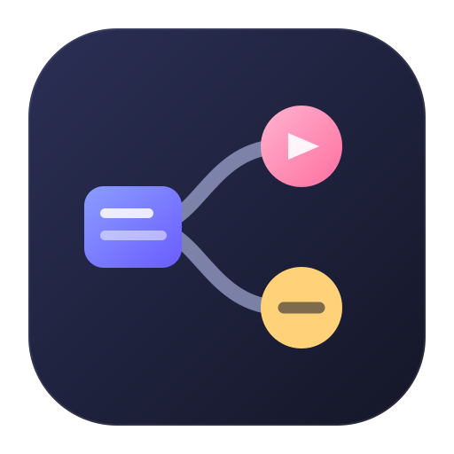

<p align="center">
  
</p>

<h1 align="center">Visual Novel Editor — Web edition</h1>

<p align="center">
  Build branching stories. Compose each scene. Bring your world to life.
</p>

<p align="center">
  <strong>English</strong> · <a href="README.zh-CN.md">简体中文</a>
</p>

<p align="center">
  <a href="https://github.com/D4eee/Visual-Novel-Editor/releases/latest">Download</a> ·
  <a href="docs/user-guide/README.md">User guide</a> ·
  <a href="docs/release-notes/v1.0.0.md">Release notes</a> ·
  <a href="docs/modding/README.md">Module development</a>
</p>

> Branch `web`: the editor runs in your web browser, served by a small local Node.js server (no Electron). The desktop app is on the [`desktop`](https://github.com/D4eee/Visual-Novel-Editor/tree/desktop) branch; the full source and history are on [`main`](https://github.com/D4eee/Visual-Novel-Editor/tree/main).

---

Visual Novel Editor is a standalone authoring tool for visual novels and interactive stories. Plan routes in a story graph, compose scenes with layers, animate elements on a timeline, and build interactions with visual scripting—all in one workspace.

The editor is available for **macOS, Windows, and Linux**, with **English and Simplified Chinese** interfaces. Export your game for the **web, macOS, or Windows**, so players can run it without the editor.

## A complete storytelling workspace

| Workspace | What you can create |
| --- | --- |
| **Story graph** | Organize chapters, connect scenes and choices, and build conditions, events, weighted random branches, waits, jumps, and endings. View one chapter or the whole story. |
| **Scene composition** | Arrange backgrounds, character portraits, images, text, dialogue, shapes, buttons, hotspots, audio, and video. Use groups and reusable compositions to organize scenes. |
| **Dialogue design** | Place dialogue boxes freely, create speech and thought bubbles, customize typography and appearance, import fonts, and add typewriter reveals. |
| **Timeline animation** | Animate in an After Effects-style timeline: layer bars with in and out points, grouped properties with stopwatches, a graph editor with bezier handles, markers, a work area, parent links, and motion paths on the canvas. Coordinate motion with audio, video, and effects. |
| **Presets** | Apply entrance, emphasis, and exit animations; ready-made looks for text, shapes, buttons, and dialogue boxes; effect presets; and your own saved looks, from the inspector's Presets tab. |
| **Procedural effects** | Build effects with node graphs, including blur, color adjustments, distortion, noise, and custom GLSL shaders. Save, reuse, and share presets as `.vnefx` files. |
| **Visual scripting** | Connect triggers, actions, values, and conditions with Scratch-style puzzle blocks whose shapes show how they connect. Add clickable regions, control elements and media, create reusable behaviors, and trace execution in Test mode. |
| **Game systems** | Keep music, looping animations, and scripts running between pages. Use global elements for HUDs and inventories, animate sprites, track parameters and lists, and unlock choices with collected items. |
| **AI assistant** | Chat with Claude or any OpenAI-compatible model using your own API key. The assistant writes scenes, adds elements and animations, and builds interactions through MCP-style editor tools; every reply can be undone. |
| **Preview and export** | Preview a scene, chapter, or complete game with the same runtime used in exported games. Inspect variables and execution logs, then export only the assets and runtime modules your game uses. |

A **Settings** window sets the language, theme, background and accent colors, font size, interface zoom, automatic saving, and timeline time format. Projects also support **autosave, recovery, backups, undo/redo, and versioned data migration**. Validation helps locate broken routes, missing assets, and other issues before export.

## Download and launch

Get the ready-to-run editor from [GitHub Releases](https://github.com/D4eee/Visual-Novel-Editor/releases/latest). Desktop builds do not require a separate Node.js installation.

| Your system | Download |
| --- | --- |
| macOS · Apple silicon | `Visual-Novel-Editor-<version>-mac-arm64.zip` |
| macOS · Intel | `Visual-Novel-Editor-<version>-mac-x64.zip` |
| Windows · x64 | `Visual-Novel-Editor-<version>-win-x64.zip` |
| Linux · x64 | `Visual-Novel-Editor-<version>-linux-x64.zip` |
| Web editor · Node.js 20+ | `Visual-Novel-Editor-<version>-web.zip` (from 1.0.0) |

**macOS:** Extract the archive and move `Visual Novel Editor.app` to Applications. The distributed app is not Apple-notarized. For a build you trust, the existing first-launch procedure is:

```bash
xattr -cr "/Applications/Visual Novel Editor.app"
codesign --force --deep --sign - "/Applications/Visual Novel Editor.app"
```

**Windows:** Extract the archive and open `Visual Novel Editor.exe`.

**Linux:** Extract the archive and run `visual-novel-editor`.

Release assets include `SHA256SUMS.txt` for verifying downloads. From **v1.0.0**, releases also include the web editor archive, which runs in your browser with Node.js 20 or later; you can also [run it from source](#development). The earlier **v0.3.1** release has desktop archives only.

> **Editor platforms and game export targets are different.** The Linux download runs the editor; the documented game export targets are web, macOS, and Windows.

## Your first story

1. **Create a project**, or open a copy of an included example.
2. **Write and connect scenes** in the story graph, with a separate output for each choice.
3. **Build each scene** with images, characters, dialogue, sound, and interactive elements.
4. **Add motion and behavior** using the timeline, effect graphs, and visual scripting.
5. **Preview, resolve validation errors, and export** your game.

Follow the [getting-started tutorial](docs/user-guide/getting-started.md) for a small story with two routes. For the Chinese tutorial, switch to the [Chinese README](README.zh-CN.md).

## What's new in 1.0.0

- **AI assistant:**
  - a chat panel next to the tab bar (Ctrl/⌘+J);
  - works with your own key for Claude or an OpenAI-compatible service;
  - edits the project through 24 MCP-style editor tools;
  - every reply can be undone, and there is a read-only mode.
- **Settings window:** language, themes, background and accent colors, font size, interface zoom, automatic saving, default ease, timecode and frame rate, and the AI connection.
- **After Effects-style timeline:**
  - layer bars with in and out points;
  - property groups with stopwatches, value scrubbing and keyframe navigators;
  - a graph editor with bezier handles;
  - box selection and time stretching, snapping, markers and a work area;
  - parent & link, motion paths on the canvas, and AE shortcuts.
- **Inspector tabs:**
  - Options, Effects, and Presets;
  - 18 animation presets and ready-made looks;
  - your own saved looks.
- **Puzzle-shaped blocks:**
  - blocks interlock like Scratch;
  - blocks that end a script have a flat bottom and fit only at the end.
- **New app icon**, a web editor download, and project format 4 / module API 1.3.

Read the [complete release notes](docs/release-notes/v1.0.0.md). The README describes the current source; release notes describe changes in that published version. Earlier: [0.3.1](docs/release-notes/v0.3.1.md).

## Documentation

| I want to… | Start here |
| --- | --- |
| Make my first story | [Getting started](docs/user-guide/getting-started.md) |
| Learn the editor | [User guide](docs/user-guide/README.md) |
| Let AI work on my project | [AI assistant](docs/user-guide/ai-assistant.md) |
| Change colors, fonts, and other settings | [Settings](docs/user-guide/settings.md) |
| Export a playable game | [Export guide](docs/user-guide/export.md) |
| Build a module | [Module development](docs/modding/README.md) |
| Look up SDK interfaces | [API reference](docs/api/README.md) |
| Understand the codebase | [Architecture](docs/architecture/README.md) |
| Build or package the editor | [Build and release](docs/architecture/build-and-release.md) |

See the [documentation index](docs/README.md) for an overview.

## Extend the editor

Modules can add story nodes, scene elements, properties, effects, transitions, scripting blocks, systems, panels, workspaces, importers, and exporters. A module can extend the runtime, the editor, or both.

The repository includes a **module SDK, a starter template, and seven example modules**. Project data belonging to a missing module is preserved, so reopening a project without an extension does not discard that extension's data.

## Development

Requires **Node.js 20 or later**.

```bash
npm install
npm start
```

`npm start` builds and opens the Electron desktop editor. To run the browser editor instead:

```bash
npm run serve
```

Open `http://127.0.0.1:5199`.

<details>
<summary><strong>Checks, packaging, and repository layout</strong></summary>

### Checks

```bash
npm run typecheck
npm run check-i18n
npm test
```

### Packaging

| Command | Output |
| --- | --- |
| `npm run app:mac` | Desktop app for the current Mac |
| `npm run app:win` | Windows x64 desktop archive |
| `npm run app:web` | Browser editor package; requires a local Node.js server |
| `npm run dist:mac` | macOS installer packages with electron-builder |
| `npm run dist:win` | Windows installer and ZIP archive |

Packaging downloads the Electron runtime templates used for game exports, verifies their checksums, and bundles them with the editor. See [Build and release](docs/architecture/build-and-release.md) for cross-platform packaging and signing details.

### Repository layout

| Path | Purpose |
| --- | --- |
| `packages/core` | Data model, story graph rules, validation, migration, expressions, and localization |
| `packages/runtime` | Shared game runtime for preview and exported games |
| `packages/host` | File access, project management, assets, modules, and export |
| `packages/desktop` | Electron shells for the editor and exported games |
| `packages/editor` | React editor interface |
| `sdk` | Module SDK types and helpers |
| `examples/games` | Example projects available as editor templates |
| `examples/extensions` | Seven example modules |
| `templates/extension` | Starter module template |
| `docs` | Guides, release notes, API documentation, and architecture notes |

</details>

## License

MIT
